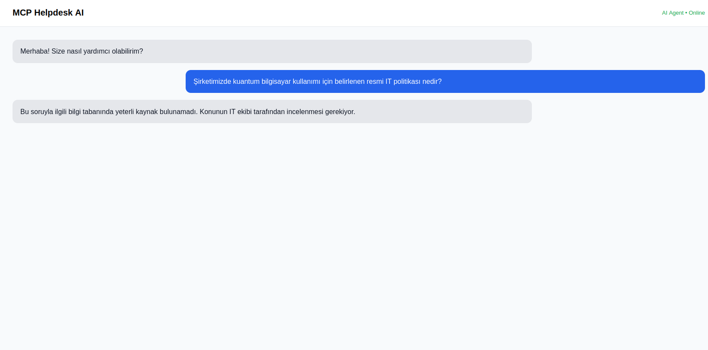
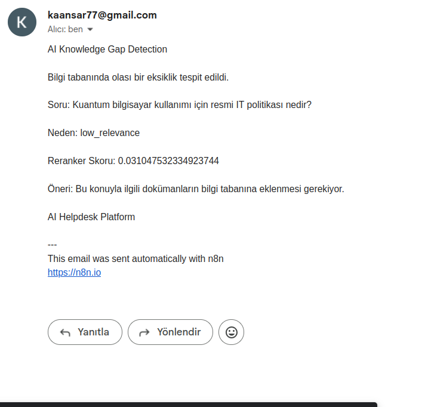
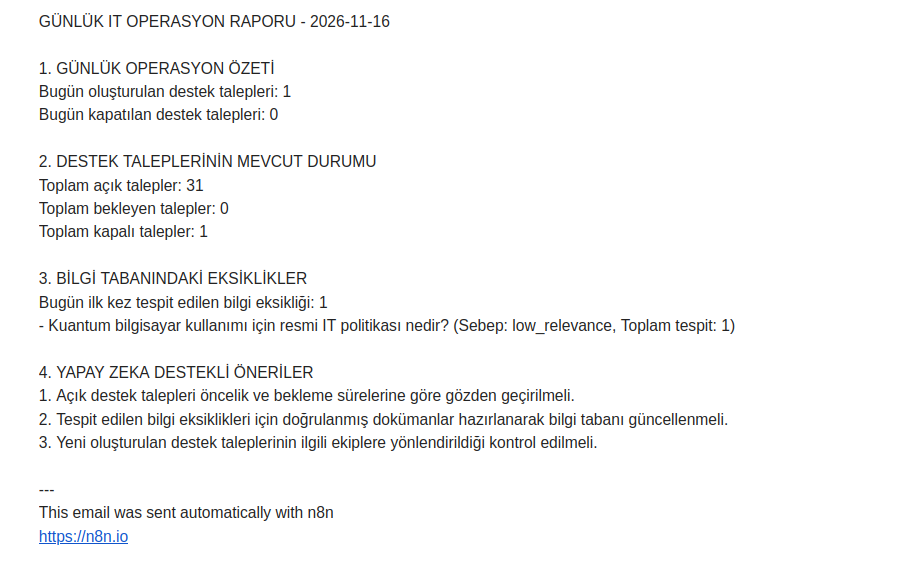

# AI Helpdesk Platform

**AI Helpdesk Platform**, şirket içi IT destek süreçleri için geliştirdiğim; **RAG, MCP tabanlı AI Agent ve n8n otomasyonlarını** bir araya getiren bir yapay zekâ portföy projesidir.

Sistem, şirket dokümanlarından kaynaklı yanıtlar üretir, kullanıcı isteğine göre araç seçerek destek kayıtlarını yönetir ve belirli işlemleri kullanıcı onayıyla gerçekleştirir.

## Teknolojiler

| Alan | Teknolojiler |
| --- | --- |
| Backend | Python, FastAPI |
| LLM ve embedding | Ollama, Llama 3, nomic-embed-text |
| RAG | PostgreSQL 16, pgvector, BAAI/bge-reranker-v2-m3 |
| Agent ve araç kullanımı | MCP (Model Context Protocol) |
| Otomasyon | n8n, webhook, e-posta |
| Altyapı ve arayüz | Docker, HTML, CSS, JavaScript |

## Temel Özellikler

- **RAG ile kaynaklı soru-cevap:** Dokümanlar parçalanıp embedding'leri PostgreSQL'de saklanır. Soruyla ilgili içerikler pgvector üzerinden bulunur, reranker ile yeniden sıralanır ve LLM'e bağlam olarak verilir.
- **MCP destekli AI Agent:** Kullanıcı isteğine göre doküman arama, kullanıcı bilgisi sorgulama ve destek kaydı oluşturma/listeleme/detay görüntüleme/durum güncelleme araçlarını seçer.
- **Human-in-the-Loop:** Destek kaydı oluşturma veya durum değiştirme gibi işlemler kullanıcı onayından sonra gerçekleştirilir.
- **Knowledge Gap Detection:** Yeterince ilgili kaynak bulunamayan sorular kaydedilir, tekrar sayıları takip edilir ve n8n ile bildirim gönderilir.
- **Doküman işleme:** İçerik çıkarma, chunking, embedding oluşturma ve vektör veritabanına kaydetme adımlarını kapsar.
- **AI destekli günlük rapor:** Destek talepleri ve bilgi eksikliği istatistikleri Python ile hesaplanır; Ollama, doğrulanan öneri seçeneklerini önceliklendirir.

## Sistem Mimarisi

```text
Kullanıcı → Sohbet Arayüzü → FastAPI
                              ├── RAG → pgvector → Reranker → Ollama
                              └── AI Agent → MCP Araçları (kullanıcı onayı)
                                          │
                              Repository Katmanı
                                          │
                               PostgreSQL 16
                                          │
                         FastAPI / Webhook ↔ n8n → E-posta
```

## n8n Otomasyonları

| Workflow | İşlev |
| --- | --- |
| Ticket Created Notification | Oluşturulan destek kaydını e-postayla bildirir. |
| Document Ingestion | Doküman işleme akışını tetikler. |
| Knowledge Gap Detection | Yeni bilgi eksikliklerini e-postayla bildirir. |
| AI Daily IT Operations Report | Günlük istatistikleri ve AI destekli önerileri e-postayla gönderir. |

## Ekran Görüntüleri

<details>
<summary><strong>RAG: Kaynaklı soru-cevap</strong></summary>


</details>

<details>
<summary><strong>MCP Agent: Kullanıcı onayı ve destek kaydı oluşturma</strong></summary>


</details>

<details>
<summary><strong>Knowledge Gap Detection</strong></summary>





</details>

<details>
<summary><strong>AI günlük raporu ve n8n otomasyonu</strong></summary>




</details>

## Yerel Çalıştırma

Python bağımlılıkları ve PostgreSQL, Ollama, n8n servisleri yapılandırıldıktan sonra:

```bash
cp .env.example .env
pip install -r requirements.txt
python -m uvicorn app.main:app --host 0.0.0.0 --port 8003
```

- **Sohbet arayüzü:** `http://localhost:8003/chat-ui`
- **API dokümantasyonu:** `http://localhost:8003/docs`

> Veritabanı şeması, modeller ve n8n workflow'ları ayrıca yapılandırılmalıdır. Bu çalışma portföy amaçlıdır; kimlik doğrulama, yetkilendirme ve üretim ortamı güvenlik gereksinimleri kapsam dışındadır.
