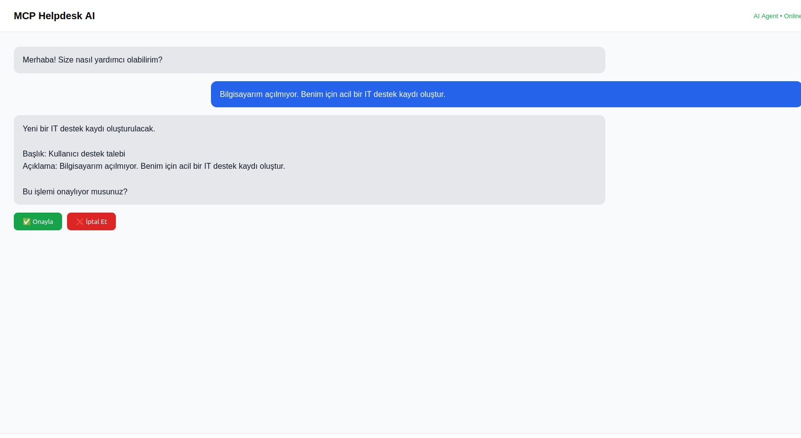
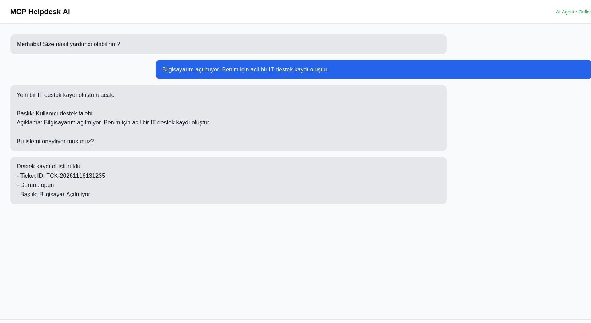
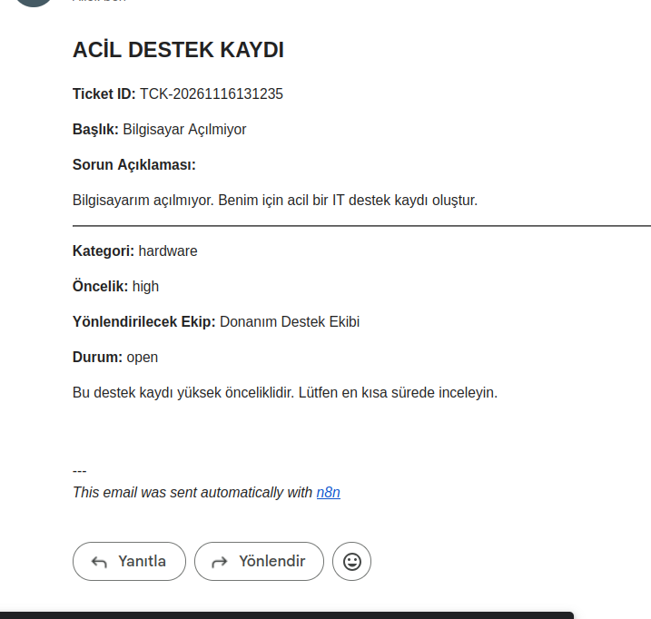
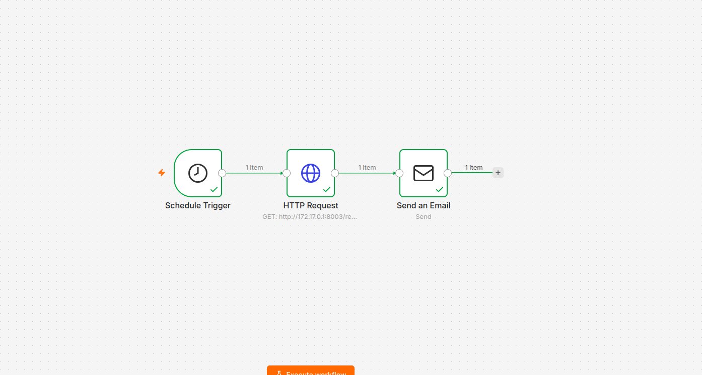
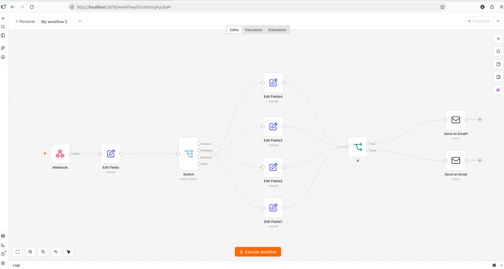

# AI Helpdesk Platform

**AI Helpdesk Platform**, şirket içi IT destek süreçleri için geliştirdiğim; **RAG, MCP tabanlı AI Agent ve n8n otomasyonlarını** bir araya getiren yapay zekâ destekli bir portföy projesidir.

Sistem, şirket dokümanlarından kaynaklı yanıtlar üretir, kullanıcı isteklerini analiz ederek uygun araçları çalıştırır, destek kayıtlarını yönetir ve çeşitli IT süreçlerini otomatikleştirir.

## 🛠️ Kullanılan Teknolojiler

| Alan | Teknolojiler |
| --- | --- |
| Backend | Python, FastAPI |
| LLM ve Embedding | Ollama, Llama 3, nomic-embed-text |
| RAG | PostgreSQL 16, pgvector, BAAI/bge-reranker-v2-m3 |
| AI Agent ve Araç Kullanımı | MCP (Model Context Protocol) |
| Otomasyon | n8n, Webhook, E-posta |
| Altyapı | Docker |
| Arayüz | HTML, CSS, JavaScript |

## 🚀 Temel Özellikler

- **RAG ile Kaynaklı Soru-Cevap:** Kullanıcı sorularıyla ilgili dokümanlar pgvector üzerinden bulunur, reranker ile yeniden sıralanır ve LLM tarafından kaynaklara dayalı yanıtlar oluşturulur.

- **MCP Destekli AI Agent:** Kullanıcı isteğini analiz ederek doküman arama, kullanıcı bilgisi sorgulama, destek kaydı oluşturma, listeleme ve durum güncelleme araçlarını seçer.

- **Human-in-the-Loop:** Destek kaydı oluşturma veya durum değiştirme gibi işlemler kullanıcı onayı alındıktan sonra gerçekleştirilir.

- **Knowledge Gap Detection:** Bilgi tabanında yeterli kaynak bulunamayan sorular tespit edilir, veritabanına kaydedilir ve n8n üzerinden bildirim gönderilir.

- **Doküman İşleme:** Dokümanlar parçalara ayrılır, embedding'leri oluşturulur ve PostgreSQL üzerinde saklanarak RAG sistemine dahil edilir.

- **AI Destekli Günlük Rapor:** Günlük destek talepleri ve bilgi eksikliği istatistikleri Python ile hesaplanır. Ollama, mevcut verilere uygun önerileri seçip önceliklendirir.

## 🏗️ Sistem Mimarisi

```text
                  Kullanıcı
                      |
                Sohbet Arayüzü
                      |
                    FastAPI
                      |
             +--------+--------+
             |                 |
          AI Agent         RAG Pipeline
             |                 |
          MCP Tools         pgvector
             |                 |
       Kullanıcı Onayı      Reranker
             |                 |
             +--------+--------+
                      |
               Repository Layer
                      |
                PostgreSQL 16

                Ollama / LLM
                      |
                 FastAPI API
                      |
                 n8n Workflows
                      |
              E-posta Bildirimleri
```

## ⚙️ n8n Otomasyonları

Projede dört farklı otomasyon geliştirilmiştir.

| Workflow | Açıklama |
| --- | --- |
| **Ticket Created Notification** | Oluşturulan destek kayıtlarını e-postayla bildirir. |
| **Document Ingestion** | Doküman işleme sürecini tetikler. |
| **Knowledge Gap Detection** | Bilgi tabanında tespit edilen yeni eksiklikleri bildirir. |
| **AI Daily IT Operations Report** | Günlük IT istatistiklerini ve AI destekli önerileri e-postayla gönderir. |

## 📸 Ekran Görüntüleri

### 1. RAG — Kaynaklı Soru-Cevap


### 2. MCP Agent — Kullanıcı Onayı



### 3. Destek Kaydı Oluşturma



### 4. n8n Ticket Bildirimi



### 5. Knowledge Gap Detection


### 6. Knowledge Gap E-posta Bildirimi


### 7. AI Günlük Operasyon Raporu


### 8. n8n Günlük Rapor Otomasyonu



### 9. n8n Otomasyon Mimarisi



## 💻 Yerel Çalıştırma

PostgreSQL, Ollama ve n8n servisleri yapılandırıldıktan sonra:

```bash
python -m venv .venv
source .venv/bin/activate

pip install -r requirements.txt

cp .env.example .env

python -m uvicorn app.main:app --host 0.0.0.0 --port 8003
```

**Sohbet Arayüzü:** `http://localhost:8003/chat-ui`

**Swagger API:** `http://localhost:8003/docs`

> **Not:** Veritabanı şeması, Ollama modelleri ve n8n workflow'ları ayrıca yapılandırılmalıdır. Proje portföy amaçlı geliştirilmiştir. Üretim ortamına yönelik kimlik doğrulama ve yetkilendirme gibi güvenlik geliştirmeleri kapsam dışındadır.